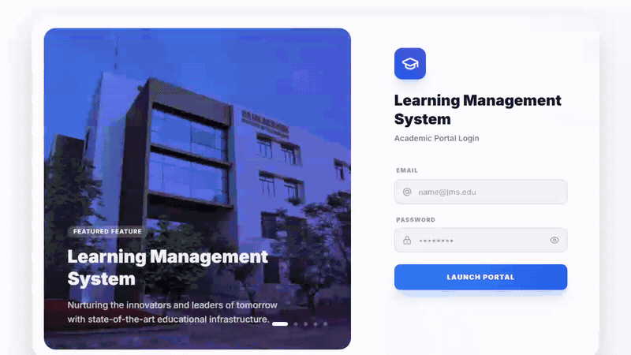

# Learning Management System (LMS)

A modern, full-stack Learning Management System built with a Spring Boot Java backend, React frontend, MySQL database, and Groq AI assistance. This platform enables educational institutions to manage courses, assessments, student progress, and academic administration.

## Features

- **Role-Based Access Control**: Tailored dashboards for Students, Instructors, and Administrators.
- **Course & Content Management**: Manage courses, modules, syllabus, assignments, and announcements.
- **Assessments & Evaluation**:
  - Interactive quizzes with instant scoring.
  - Assignments with document submission and grading.
  - Internal marks tracking.
- **AI Assistant**: Integrated AI assistant powered by the Groq API (`llama-3.3-70b-versatile`) for fast academic help and tutoring.
- **Student Engagement**: Track student achievements, progress, and performance badges.
- **Communication & Timetable**: Institution-wide announcements and shared academic schedules.

## Tech Stack

- **Backend**: Java 17, Spring Boot 3, Spring Data JPA, Spring Security
- **Frontend**: React.js, Vite, Tailwind CSS, Lucide Icons
- **Database**: MySQL (port 3306)
- **AI Engine**: Groq API (`llama-3.3-70b-versatile`)

## Getting Started

### Prerequisites

- Java JDK 17+
- Node.js (v18+) & npm
- MySQL Server (running on port 3306)
- Groq API Key (set `GROQ_API_KEY` environment variable or `app.groq.api-key` in `lms-backend/src/main/resources/application.properties`)

### Quick Start (All-in-One)

Start backend and frontend with a single command:
```powershell
.\run.ps1
```
Or double-click:
```cmd
run.bat
```

To stop all services cleanly:
```cmd
stop.bat
```

### Manual Setup

1. **Backend**
   ```bash
   cd lms-backend
   .\mvnw spring-boot:run
   ```
   Backend starts at: `http://localhost:8080`

2. **Frontend**
   ```bash
   cd lms-frontend
   npm install
   npm run dev
   ```
   Frontend starts at: `http://localhost:5173`

## Default Credentials

- **Admin**: `admin@lms.edu` / `admin123`
- **Instructor**: `instructor@lms.edu` / `instructor123`
- **Student**: `student@lms.edu` / `student123`

## Project Demo Walkthrough

A walkthrough demonstrating authentication, admin controls, instructor course workflows, AI assistant queries, and student dashboards:



